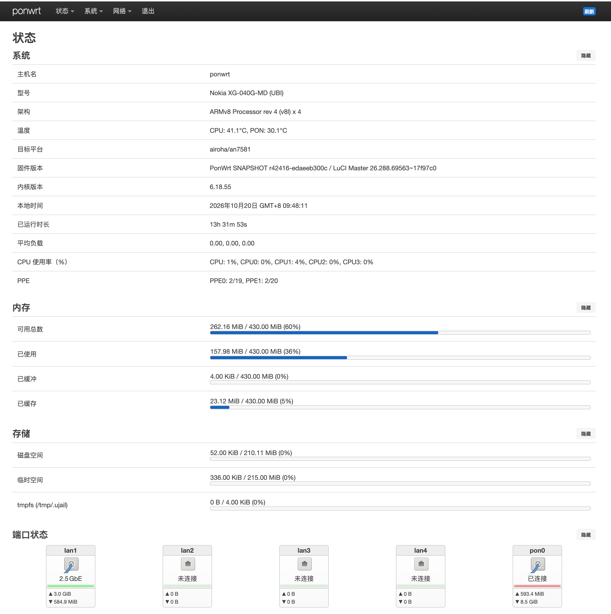

# Nokia XG-040G-MD 精简版 PonWrt 固件

基于 PonWrt 的 Airoha AN7581 固件编译配置，当前仅编译 **Nokia XG-040G-MD（UBI）**。构建源码使用 [1018ji/merge-immortalwrt-ponwrt](https://github.com/1018ji/merge-immortalwrt-ponwrt) 的 `master` 分支。

本配置以精简为主，关闭 USB/存储、无线、VPN、网络扩展及调试工具，保留 PON 管理、基础 IPv6、BBR、LuCI 中文界面和 Bootstrap 主题。Initramfs 改用 ZSTD 压缩，移除 LuCI「插件」「诊断」菜单，并新增 CPU/PON 温度显示、CPU 使用率附加 PPE 流表统计、最大连接数调整、脚本权限修复及 BusyBox `usleep`。

构建工作流位于 [`.github/workflows/ponwrt-builder.yml`](.github/workflows/ponwrt-builder.yml)，在 **Actions → PonWrt Builder → Run workflow** 中手动运行，编译成功后会将 `.itb` 固件发布到 **Releases**（以北京时间 `YYYY-MM-DD-HH-MM-SS-毫秒` 命名，仅保留最新 7 个），Actions 运行记录同样仅保留最新 7 条。勾选 `ssh` 后，可从 **Setup SSH session** 日志复制 SSH 命令连接构建环境，编译会继续运行。SSH 仅允许触发任务的账号使用其 GitHub 公钥连接，请先将本机 SSH 公钥添加到 GitHub 账号的 **Settings → SSH and GPG keys**。源码目录为 `/workdir/openwrt`，调试完成后执行 `exit` 结束会话，以免任务在最后等待。

| 类型 | 项目 | 上游配置 | 本仓库调整 |
| --- | --- | --- | --- |
| 调整 | 编译设备 | 同时选择 12 个设备配置，含 USB/SFP 变体 | 仅选择 `nokia_xg-040g-md-ubi`，关闭其他设备配置 |
| 调整 | Initramfs 压缩 | 不压缩 | 改用 ZSTD 压缩，保留 SquashFS 根文件系统 |
| 精简 | USB 与存储 | 选中 USB 3.0、USB 存储、UAS、USB 端口 LED、`block-mount` 及 ext4/vfat/exfat 模块 | 关闭相关模块及依赖，并从目标设备默认包中显式排除 USB、挂载和文件系统扩展包 |
| 精简 | 无线功能 | 选中 MT7915/MT7916、mac80211、wpad、无线工具及相关固件 | 关闭无线驱动、固件、认证、管理工具及相关依赖 |
| 精简 | LuCI 主题 | 同时选择 Bootstrap 和 Argon | 移除 `luci-theme-argon`，仅保留 Bootstrap |
| 精简 | DNS 扩展 | `dnsmasq-full` 启用 DNSSEC、权威 DNS、conntrack 和 TFTP | 关闭上述扩展，保留 DHCP、DHCPv6 和 nftset |
| 精简 | VPN 与隧道 | 启用 WireGuard、TUN、OpenVPN backports、MPPE 和 UDP 隧道模块 | 关闭 `kmod-wireguard`、`kmod-tun`、`kmod-ovpn-backports`、`kmod-udptunnel4/6`；`kmod-mppe` 为 `ppp` 包强制依赖，保留 |
| 精简 | 内核加密模块 | 选中 WireGuard 所需的 `kmod-crypto-chacha20poly1305`、`kmod-crypto-kpp` 及 `kmod-crypto-lib-chacha20/chacha20poly1305/curve25519/poly1305` | 随 WireGuard 关闭这些模块；dropbear、OpenSSL 自带的 ChaCha20/Curve25519 不受影响 |
| 精简 | 透明代理模块 | 启用 MACVLAN、nf/nft socket 和 TPROXY 模块 | 关闭 nf/nft socket 和 TPROXY 模块；`kmod-macvlan` 为 `ppp` → `shellsync` 强制依赖，保留 |
| 精简 | 内核网络扩展 | 启用 IPv4/IPv6 组播路由、PIM、IPv6 SEG6 LWTUNNEL 和 MPTCP | 关闭上述内核选项，保留基础 IPv6 支持 |
| 精简 | 流量调度 | 启用 CAKE 和 BBR 模块 | 关闭 `kmod-sched-cake`，保留原有 `kmod-tcp-bbr` |
| 精简 | 调试与网络工具 | 启用 `airoha-pon-debug`、`conntrack`、`ethtool-full`、`ip-full`、`ip-bridge`、`iperf3`、`tcpdump`、`i2c-tools`、`wget-ssl` | 关闭这些工具；保留 PON 管理所需的 `airoha-ponctl`、`airoha-pond` 和 LuCI PON 页面 |
| 精简 | 相关依赖库 | 选中 `libbpf`、`libelf`、`libpcap`、`libpcre2`、`libiperf3`、`libiwinfo`、netfilter 相关库等 | 随功能精简关闭对应依赖库的编译选项 |
| 精简 | 内核 namespace/cgroup/异步 I/O | 启用全部 namespace（UTS/IPC/USER/PID/NET/TIME）、MEMCG、块设备 cgroup 与限速、cgroup BPF、RT/CFS 带宽控制、CPUSETS、RDMA cgroup、io_uring、AIO、fanotify、POSIX 消息队列 | 关闭上述选项；保留 procd 所需的 `CGROUPS`、`CGROUP_PIDS`、`FREEZER`、`CGROUP_CPUACCT`、`CGROUP_SCHED`、`FAIR_GROUP_SCHED`。如需 Docker/LXC 或重新启用 `procd-ujail`，需恢复相应选项 |
| 精简 | 内核调试 | 启用内核调试、调试信息、KALLSYMS、Magic SysRq、core dump 和 relay | 关闭这些调试选项 |
| 精简 | procd 沙箱 | 选中 `procd-ujail` 和 `procd-seccomp` | 关闭 `procd-ujail`，服务不再以 namespace/chroot 沙箱启动；保留 `procd-seccomp` 系统调用过滤 |
| 精简 | Swap | 启用 `CONFIG_KERNEL_SWAP` | 关闭内核 Swap 支持 |
| 精简 | 开发工具链 | 启用开发模式、GDB、BPF 主机工具链和主机 LLVM 选项 | 关闭对应选项，BPF 工具链改为 `NONE` |
| 精简 | OpenSSL | 启用 ENGINE、CMS、废弃接口、部分旧算法和 `libopenssl-legacy` | 关闭上述选项及 `OPENSSL_WITH_ERROR_MESSAGES`（错误只显示错误码），启用 `OPENSSL_NO_DEPRECATED`；保留 OpenSSL 主库 |
| 精简 | Dropbear | 启用 SSH 客户端 `dbclient`、客户端转发、agent 转发、远程端口转发和 FIDO 硬件密钥（`sk-*`） | 关闭 `DROPBEAR_DBCLIENT`、`CLI_*`、`USE_PASSWORD_ENV`、`SVR_AGENTFWD`、`SVR_REMOTETCPFWD`、`SK_KEYS/SK_ECDSA/SK_ED25519`；保留 SSH 服务端、公钥/密码登录、`scp`/`sftp` 服务端和 `ssh -L` 本地转发 |
| 调整 | 未启用应用的附加选项 | IPTV 设备默认项、PassWall 和 Rclone 的部分附加选项仍启用 | 清理这些默认/附加选项；IPTV、PassWall、Rclone 应用在两份配置中均未启用 |
| 精简 | BusyBox 小工具 | 启用 `mkswap`、`swapon`、`swapoff`、`brctl`、`netmsg`，以及 `mount` 的 CIFS 和 loop 支持 | 关闭这些小工具和 `mount` 的 CIFS、loop 支持（内核已无 Swap 和存储支持，网桥由 netifd/`ip` 管理） |
| 新增 | BusyBox `usleep` | 未启用 `CONFIG_BUSYBOX_CONFIG_USLEEP` | 启用微秒级休眠命令 `usleep` |
| 精简 | LuCI 菜单 | 显示「系统 → 插件」和「网络 → 诊断」 | `diy-part2.sh` 编译前从 `luci-mod-system`、`luci-mod-network` 菜单定义中移除这两项并删除对应页面；菜单项不存在时编译中止 |
| 新增 | CPU/PON 温度显示 | 配置文件不涉及自定义温度脚本 | 添加 `files/sbin/tempinfo`，从 `thermal_zone0` 读取 CPU 温度，从 `ponctl status --json` 读取 PON 前端温度 |
| 新增 | 每核 CPU 使用率与 PPE 流表 | 状态页仅显示 CPU 总使用率 | 添加 `files/sbin/cpuusage`，`diy-part2.sh` 将 LuCI `getCPUUsage` 改为调用该脚本，并修改状态页 `10_system.js`：「CPU 使用率」行显示总使用率和每个核心的使用率（两次采样 `/proc/stat`，间隔 0.25 秒），如 `CPU: 3%, CPU0: 8%, CPU1: 2%, CPU2: 1%, CPU3: 1%`；单独的「PPE」行按 `PPE0/PPE1`（`/sys/kernel/debug/ppe/entries` 索引区间划分）分别显示已绑定/总条目数（IPv4 与 IPv6 合计），如 `PPE0: 7/68, PPE1: 11/83`（不含 L2B、DS-LITE、6RD 条目）；替换失败时编译中止 |
| 调整 | 架构信息精简 | autocore 的 `/sbin/cpuinfo` 在架构后附加 CPU 频率和温度 | 添加 `files/sbin/cpuinfo` 覆盖 autocore 版本，状态页「架构」只显示 `ARMv8 Processor rev 4 (v8l) x 4`，温度见「温度」行 |
| 调整 | 最大连接数 | 使用内核默认的 `nf_conntrack_max` | 添加 `files/etc/sysctl.d/99-nf-conntrack-max.conf`，将最大连接数设为 `30000`（LuCI「活动连接」上限） |
| 新增 | 脚本权限修复 | 配置文件不涉及首次启动脚本 | 添加 `files/etc/uci-defaults/98-script-perm`，首次启动时补齐 `/sbin/tempinfo`、`/sbin/cpuusage`、`/sbin/cpuinfo` 的执行权限 |

表中的“关闭”指关闭编译选项，包含上游选为 `y` 或 `m` 的包。基础 LuCI 中文界面、PON 管理和 BBR 均为上游已有功能。
